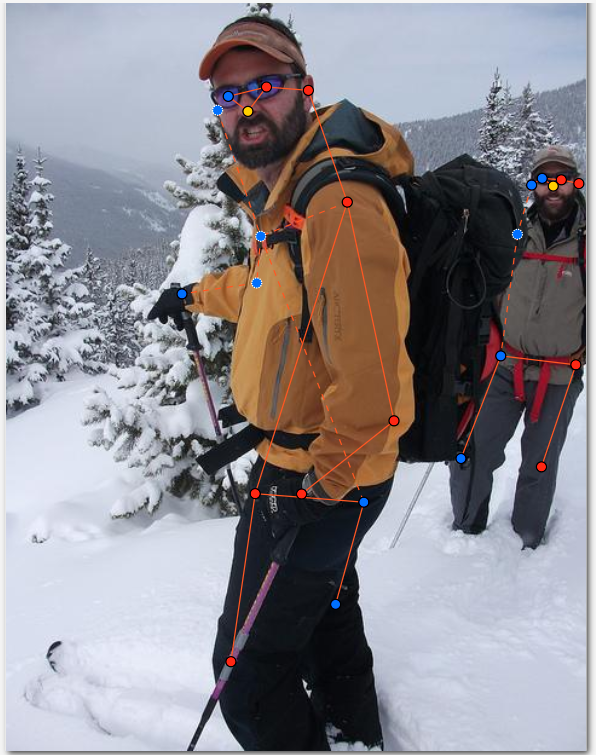
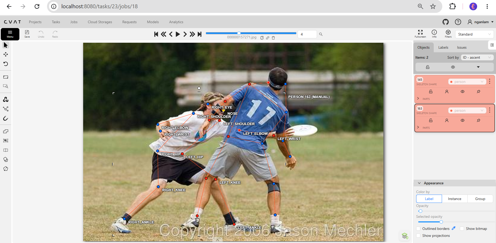
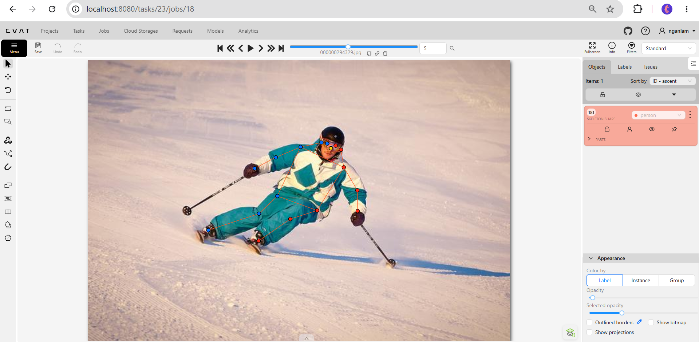

# Báo cáo cá nhân — Lâm Hoài Kim Ngân - 2A202603305

Dữ liệu: 12 ảnh người COCO val2017 (Lin et al., 2014) và 8 ảnh chân dung Wikimedia Commons, chỉ dùng trong lớp.

## 0. Thông tin học viên

- Họ tên: Lâm Hoài Kim Ngân
- MSSV: 2A202603305 
- Email: lamhoaikimngan91@gmail.com
- Link repository:https://github.com/nganlam-vn/K5-L2-LamHoaiKimNgan-2A202603305-Day04-KeypointPose-Student
- Phiên bản CVAT (Help → About):2.5.1
- Máy: hệ điều hành Window · RAM 16 GB · chạy CVAT chế độ lite
- Bộ ảnh (`src/exports/assignment.json` do `lab.py setup` tạo): có
- Giờ bắt đầu: 16:30 12/11/2026
- Giờ kết thúc: 18:50 12/11/2026

## 1. Kiểm tra label (CP0)

| Label | Kiểu | Số điểm | Tên điểm đúng bảng của lab? | Đúng thứ tự? | Số cạnh |
|---|---|---:|---|---|---:|
| `person` | skeleton | 17 |  Đúng | Có | -|
| `face` | skeleton | 13 | Đúng | Có | - |

Mẫu `person` dựng theo người quay mặt về camera (các điểm `left_*` nằm bên phải khung mẫu)? Có 

Cách đổi cờ `occluded` / `outside` cho **một điểm** trên phiên bản CVAT này (một câu):
click điểm và nhấn phím Q

## 2. Số lượng đã gán và thời gian (CP1, CP2)

| Nhóm ảnh | Số ảnh | Số skeleton đã gán | Số người dưới 60 px (không gán) | Số poster / gương / màn hình bỏ qua | Thời gian (phút) |
|---|---:|---:|---:|---:|---:|
| `easy` | 5 | 5 | 0 | 0 | 25 |
| `occluded` | 3 | 6 | 0 | 0 | 25 |
| `back` | 2 | 4 | 0 | 0 | 18 |
| `small` | 1 | 0 | Đám đông bóng người | 0 | 8 |
| `crowd` | 1 | 2 | ~10 (đám đông đằng sau) | 0 | 14 |
| `faces` | 8 | 8 | — | 0 | 25 |

- Số ảnh người đã xong ở mốc phút 105: 10 / 10
- Thời gian thực tế (phút): CP1 90 · CP2 25 · CP3 15
- Ảnh tốn thời gian nhất là ảnh nào, vì sao?

Ảnh  (nhóm `occluded`, cảnh 2 người tranh chấp ném đĩa frisbee):
- **Vì sao tốn thời gian:**
  1. Người áo xanh số 17 **quay lưng** về phía camera, đòi hỏi phải đảo ngược toàn bộ quy ước điểm trái/phải (`left_*` nằm bên trái ảnh, `right_*` nằm bên phải ảnh) để tránh mắc lỗi `lr_swap`.
  2. Hai người vận động mạnh và **che khuất nhau rất nhiều** (người áo xanh che phần thân và cánh tay người áo trắng phía sau, hai người có chân và tay đan xen nhau).
  3. Nhiều điểm trên khuôn mặt và các khớp bị che phải phóng to để ước lượng vị trí giải phẫu tự nhiên và cân nhắc đặt cờ `occluded` (`v = 1`) hoặc `outside` (`v = 0`) một cách cẩn trọng.

## 3. Bảng ca khó (CP1, CP2)

Mỗi điểm bạn phân vân một dòng, nhất là phân vân giữa `v = 1` và `v = 0`, hoặc không chắc hướng người.
ảnh 1:

ảnh 2:


| Ảnh | Người / mặt | Điểm | Cờ đã chọn | Phân vân giữa | Lý do chọn |
|---|---|---|---:|---|---|
| ảnh 1 | Người áo vàng (#1) | `left_ankle`, `right_ankle` | 0 | `v = 1` và `v = 0` | Cổ chân và bàn chân chìm hoàn toàn trong tuyết dày, không thấy bề mặt để định vị chính xác khớp nên chọn `v = 0` thay vì đoán bừa. |
| ảnh 2 | Người áo xanh số 17 (#1) | `nose`, `left_eye`, `right_eye` | 0 | `v = 1` và `v = 0` (và đổi trái/phải do quay lưng) | Người quay lưng về camera, mắt và mũi ở mặt trước bị đầu che khuất hoàn toàn, không thể xác định vị trí nên chọn `v = 0`. |

## 4. Bảng tự review (CP3)

Đi từ ảnh cuối về ảnh đầu. 5 ảnh người (ít nhất 2 ảnh `back` hoặc `crowd`) và 3 ảnh mặt. Ít nhất 8 dòng, kể cả dòng `ok`. Ghi lỗi trước, sửa sau.

Mã lỗi dùng đúng một trong: `lr_swap`, `vis_flag`, `position`, `missing`, `extra`, `ok`.

| Ảnh | Người / mặt | Điểm | Mã lỗi | Ghi chú | Đã sửa? |
|---|---|---|---|---|---|
| `000000130816.jpg` | Người chơi bóng #2 | `left_knee`, `right_knee` | `vis_flag` | Chân bị người phía trước che khuất hoàn toàn, đổi từ `v = 1` sang `v = 0` | Có |
| `000000480582.jpg` | Người quay lưng #1 | `left_shoulder`, `right_shoulder` | `lr_swap` | Người quay lưng, ban đầu nhầm trái/phải, đã đảo lại các điểm `left_*` sang bên trái ảnh | Có |
| `000000069971.jpg` | Người #2 | `right_elbow` | `position` | Điểm khuỷu tay hơi lệch ra ngoài mép áo, đã kéo lại đúng khớp | Có |
| `000000157271.jpg` | Người áo xanh #1 | `nose`, `left_eye`, `right_eye` | `vis_flag` | Người quay lưng bị đầu che kín mắt/mũi, đổi cờ sang `v = 0` | Có |
| `000000122199.jpg` | Người áo vàng #1 | `left_hip`, `right_hip` | `position` | Chỉnh lại vị trí khớp hông giải phẫu qua lớp áo khoác dày phồng | Có |
| `face_490361.jpg` | Khuôn mặt #1 | Toàn bộ 13 điểm | `ok` | Mặt thẳng rõ nét, các điểm mí mắt, khóe miệng và chóp mũi chính xác | — |
| `face_146049.jpg` | Khuôn mặt #1 | `left_eye_*`, `right_eye_*` | `vis_flag` | Vùng mắt bị che khuất hoàn toàn không thấy mép mí, đổi cờ sang `v = 0` | Có |
| `face_342273.jpg` | Khuôn mặt #1 | `left_eye_inner` | `position` | Khóe mắt trong bị lệch vào sống mũi, đã chỉnh lại sát góc mắt | Có |

Tổng hợp số lỗi theo mã:   

| `lr_swap` | `vis_flag` | `position` | `missing` | `extra` | `ok` |
|---:|---:|---:|---:|---:|---:|
| 1 | 3 | 3 | 0 | 0 | 1 |

Điểm còn phân vân giữa `v = 1` và `v = 0` (ghi cả hai lựa chọn và lý do chọn):

- **Ảnh `000000122199.jpg` (Cổ chân `left_ankle`, `right_ankle` của người áo vàng và người đi sau)**:
  - *Lựa chọn*: `v = 1` (occluded) nếu giả định vị trí khớp ngay dưới ống quần cắm xuống tuyết; `v = 0` (outside/không xác định) do tuyết dày vùi lấp hoàn toàn.
  - *Lý do chọn*: Chọn `v = 0` theo đúng guideline, không đoán mò khi không thấy bề mặt khớp để tránh đưa dữ liệu nhiễu vào mô hình.
- **Ảnh `face_146049.jpg` (Các điểm mắt `*_eye_*`)**:
  - *Lựa chọn*: `v = 1` nếu ước lượng vùng hốc mắt sau vật che; `v = 0` do không quan sát được mép mí mắt và con ngươi.
  - *Lý do chọn*: Chọn `v = 0` vì landmark mắt cần chính xác từng pixel để đo tỉ lệ mở mắt (EAR), ước lượng thiếu cơ sở sẽ làm sai lệch mô hình giám sát buồn ngủ.

## 5. Kiểm file xuất và kết quả tự kiểm (CP4)

Tự kiểm tay trong file JSON:

| File | Người / mặt kiểm (ảnh, thứ tự) | Số phần tử `keypoints` | Điểm `outside` ra `v = 0`, `occluded` ra `v = 1`? | `num_keypoints` khớp? |
|---|---|---:|---|---|
| `LamHoaiKimNgan_persons.zip` | `000000030960.jpg` (#1) | 51 | Đúng (`outside` → `v = 0`, `occluded` → `v = 1`) | Khớp (`num_keypoints` = 11) |
| `LamHoaiKimNgan_persons.zip` | `000000030960.jpg` (#2) | 51 | Đúng (`outside` → `v = 0`, `occluded` → `v = 1`) | Khớp (`num_keypoints` = 15) |
| `LamHoaiKimNgan_faces.zip` | `face_146049.jpg` (#1) | 39 | Đúng (`outside` → `v = 0`, `occluded` → `v = 1`) | Khớp (`num_keypoints` = 5) |

Sau khi xuất, CVAT ghi `occluded` thành `v = 1` và `outside` thành `v = 0`. Tọa độ của điểm `outside` trong file là `0, 0` hay tọa độ cũ? tọa độ cũ (79 điểm v = 0 vẫn mang tọa độ cũ do CVAT 2.x xuất như vậy; chuẩn COCO ghi 0, 0; không phải lỗi: điểm v = 0 bị bỏ qua khi huấn luyện và khi chấm).

Hai job đã chuyển sang completed trên CVAT? Có

Dán phần **TÓM TẮT** in ra từ `src/check_submission.py`:


```text
- Số [LỖI]: 0 · số [CẢNH BÁO]: 2
Kết quả: ĐẠT (đọc lại từng cảnh báo ở trên)
```

Các `[CẢNH BÁO]` còn giữ nguyên và lý do:

- `[CẢNH BÁO] 000000122199.jpg #1: cặp hip, knee nằm ngược phía so với các cặp còn lại. Có thể đổi trái/phải một cặp (lr_swap), hoặc tay / chân bắt chéo thật: kiểm lại.`
  - Lý do: Tư thế thực tế của đối tượng trong ảnh là chân bắt chéo / xoay người tự nhiên; các điểm khớp đã được kiểm tra cẩn thận và đặt đúng theo giải phẫu của người trong ảnh, không phải lỗi đổi trái/phải (`lr_swap`).
- `[CẢNH BÁO] 000000323705.jpg: không có skeleton person nào. Ảnh nào cũng có ít nhất một người cần gán.`
  - Lý do: Ảnh thuộc nhóm `small`, toàn bộ người xuất hiện chỉ thấy bóng mờ/ngược sáng, không nhìn rõ các bộ phận và khớp cơ thể (chiều cao dưới 60 px) nên quyết định không gán skeleton theo đúng quy định để tránh đoán bừa làm sai lệch dữ liệu.

## 6. Ảnh chụp màn hình

1. Label `person` trong label constructor (đủ 17 điểm có tên):

   

2. Một người quay lưng đã gán, cờ đã đặt:

   

3. Một khuôn mặt đã gán 13 điểm, phóng to vùng mắt:

   

4. Một đoạn JSON xuất của một người:

   


## 7. Tự đánh giá

1. Lỗi bạn mắc nhiều nhất hôm nay, và cách bạn sẽ tránh ở dự án thật:

   - **Lỗi mắc nhiều nhất:** Nhầm lẫn bên trái/phải (`lr_swap`) khi gặp người quay lưng hoặc xoay nghiêng người, và phân vân giữa cờ `v = 1` với `v = 0` khi khớp bị che khuất (như chân vùi trong tuyết).
   - **Cách tránh:** Luôn xác định rõ hướng người trước khi đặt điểm; với người quay lưng phải đảo sẵn các điểm `left_*` sang bên trái ảnh ngay từ đầu; kiên quyết chọn `v = 0` khi không thấy bề mặt khớp thay vì đoán mò.

2. Một quy tắc bạn đề xuất thêm vào guideline (kèm ảnh ví dụ nếu có):

   - **Quy tắc đề xuất:** Thêm hướng dẫn rõ ràng cho trường hợp người bị ngược sáng/bóng mờ (silhouette) hoặc bị vùi lấp trong tuyết/nước: Nếu toàn thân là bóng đen không nhìn rõ khớp thì thống nhất không gán skeleton; nếu chi dưới bị vùi lấp hoàn toàn không thấy bề mặt thì quy định đồng nhất đặt `v = 0` (outside).

3. Nhãn của bạn đi vào model ở đâu? Chọn một lỗi bạn đã sửa và nói nó sẽ làm model học sai thế nào (heatmap, trọng số trong loss, hay bước lật ảnh):

   - **Lỗi đã sửa:** Lỗi đảo trái/phải (`lr_swap`) ở khớp vai người quay lưng.
   - **Tác động đến model:** Nhãn keypoint đi vào model để tạo ground-truth Gaussian heatmap cho từng khớp và tham gia vào bước lật ảnh ngẫu nhiên (horizontal flip) khi augment dữ liệu. Nếu bị `lr_swap`, bước lật ảnh sẽ tráo đổi nhãn sai lệch hoàn toàn so với hình ảnh thực tế, khiến hàm loss phạt sai kênh heatmap và làm model học bối rối, không thể hội tụ để phân biệt bên trái và bên phải của cơ thể.

## 8. Khó khăn và lỗi kỹ thuật

...

## Bonus (nếu làm)

### B1 — 3 ảnh người khó thêm

| Ảnh | Số skeleton | Số người dưới 60 px | Ca khó nhất |
|---|---:|---:|---|
| | | | |
| | | | |
| | | | |

Kết quả `src/check_submission.py` cho `HoVaTen_bonus_persons.zip`:

```text
(dán ở đây)
```

### B2 — 5 ảnh khuôn mặt đen trắng / hồng ngoại

Ảnh không màu khó hơn ở điểm nào? Kính râm trên ảnh hồng ngoại có còn là `v = 1` không?

...

### B3 — Model so với nhãn của tôi (không tính điểm)

- Demo đã dùng:
- Ảnh đã thử:

1. Model có trả điểm cho khớp bị che, hay khớp ngoài ảnh không? Confidence ở các điểm đó thế nào?

   ...

2. Với người quay lưng, model có đổi trái/phải không?

   ...

3. Bộ điểm của model có giống 17 điểm COCO không?

   ...

## 9. Tài liệu tham khảo và công cụ AI đã dùng

...
